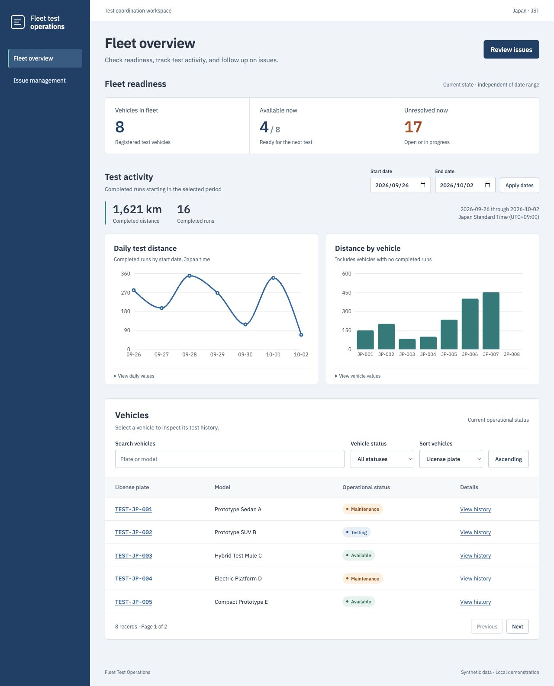
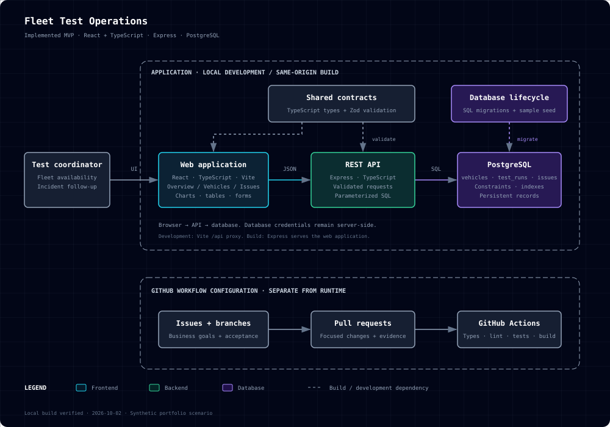
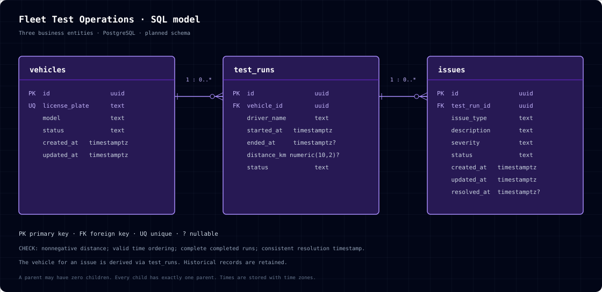

# Fleet Test Operations Dashboard

[](README.ja.md)

A working full-stack portfolio demo for an automotive test coordinator: identify available vehicles, inspect test evidence, and record incident follow-up.

Built with **React + TypeScript, Express, and PostgreSQL**. All application code and interface copy use English.

This is an independent project using fictional vehicles, drivers, and incidents. The scenario is a proposed business use case; it does not describe Bosch's internal systems.



[Issue management preview](docs/screenshots/issues.png) · [Mobile overview](docs/screenshots/overview-mobile.png) · [Mobile issue form](docs/screenshots/issue-form-mobile.png)

## Business workflow

**Find a critical open issue → inspect its vehicle and test run → resolve or reopen the issue → update vehicle readiness → reload to confirm persistence.**

| Screen           | Working capabilities                                                                                                             |
| ---------------- | -------------------------------------------------------------------------------------------------------------------------------- |
| Fleet overview   | Current readiness, selected-period distance, daily/vehicle charts with exact-value tables, vehicle search/status/sort/pagination |
| Vehicle details  | Date-filtered run history, driver snapshots, recorded distance, linked issue counts, saved operational-status changes            |
| Issue management | Vehicle/run selection, creation, URL filters, severity/status edits, resolution timestamps, reopening                            |

Follow the [five-minute demo walkthrough](docs/demo-walkthrough.md) for an interview presentation. The initial seed contains 8 vehicles, 60 test runs across 20 JST dates, and 24 issues, including a vehicle with no runs and a run with multiple issues. Saved edits can change the visible counts.

## Metric definitions

| Metric                    | Scope and calculation                                                                                            |
| ------------------------- | ---------------------------------------------------------------------------------------------------------------- |
| Vehicles / available now  | Whole fleet's current state; available means `vehicles.status = 'available'`                                     |
| Unresolved now            | All issues whose status is `open` or `in_progress`, regardless of date                                           |
| Completed distance / runs | Completed runs whose **start time** falls inside the selected JST dates; cancelled/in-progress runs are excluded |
| Daily distance            | Same completed runs grouped by their JST start date; dates with no runs show zero                                |
| Vehicle distance          | Same period calculation, including registered vehicles with zero distance                                        |

End dates are inclusive in the interface. SQL uses a half-open UTC interval ending at the next JST midnight. Timestamps display Japan Standard Time (UTC+09:00); distance is kilometers. Distances are aggregated before issue joins, so several issues do not multiply a run's mileage. A missing recorded distance displays an explanatory dash.

## Architecture



[Standalone HTML diagram](docs/architecture.html): download and open it in a browser. It includes the architecture-diagram skill's original copy/PNG/PDF toolbar; the static SVG works directly in GitHub. The toolbar's image/PDF export uses its pinned external libraries and requires network access. Browser rendering was checked; automated download capture was unavailable.

| Layer     | Implementation                                                                    |
| --------- | --------------------------------------------------------------------------------- |
| Web       | React, TypeScript, Vite, React Router, Recharts; locally bundled IBM Plex fonts   |
| API       | Node.js 24, Express 5, parameterized PostgreSQL queries                           |
| Contracts | Shared TypeScript interfaces and Zod input schemas                                |
| Database  | PostgreSQL 17, versioned SQL migration, idempotent seed                           |
| Tests     | Vitest, Testing Library, Supertest, real PostgreSQL fixtures, Playwright Chromium |
| Workflow  | Separate feature commits, Issue/PR templates, pinned GitHub Actions configuration |

Development uses a Vite `/api` proxy. Production uses one Express origin for built pages and API routes; direct vehicle URLs receive the SPA entry page, while unknown API routes stay JSON 404s. Database connection details remain on the server. Pending reads are cancelled and invalidated so older responses cannot replace newer filters.

## SQL model



- `vehicles`: unique license plate, vehicle identity, current operational status.
- `test_runs`: belongs to one vehicle; stores the driver name as a historical snapshot, start/end times, status, and distance.
- `issues`: belongs to one test run; stores incident type, description, severity, status, and resolution time.

The vehicle of an issue is derived through its run; `issues` does not duplicate `vehicle_id`. SQL enforces foreign keys, nonnegative distances, valid time ordering, completed-run completeness, allowed statuses, description length, and resolution-time consistency. A small `schema_migrations` table records applied versions.

Read the [database rationale](docs/database-model.md) and [migration](database/migrations/001_initial.sql).

## Run locally

Use **Node.js 24.x**, npm, and **PostgreSQL 17**. Check `node --version` before installing. Run commands from the repository root.

For a new checkout:

```sh
npm ci
cp .env.example .env
```

Installation compiles the shared contracts automatically. Choose a database setup:

- **Installed PostgreSQL:** follow the [native setup guide](docs/local-postgresql.md), or point `DATABASE_URL` to a dedicated existing local database. This route was tested with PostgreSQL 17.5 and Node 24.21.0, including a clean install and an empty database.
- **Docker alternative:** run `docker compose up -d --wait`. It starts PostgreSQL 17 on loopback port 5433 with the sample credentials in `.env.example`. The Docker configuration is provided; Docker startup was not exercised because the local daemon was stopped.

Use a free database port and update `DATABASE_URL` when needed. Then:

```sh
npm run db:migrate
npm run db:seed
npm run dev
```

Open [the local demo](http://127.0.0.1:5173). The API listens on 127.0.0.1:3001. Development watches both applications and the shared contracts.

Migration tracks versions; seeding inserts missing deterministic sample rows and preserves existing edits. The seed's dates are anchored when rows are first created. For a deliberate fresh set of demo dates:

```sh
npm run db:reset-demo
```

**Reset replaces saved demo edits in `issues`, `test_runs`, and `vehicles`.** It requires a loopback database named `fleet_ops`, preserves migration history, and is separate from ordinary startup. An explicit confirmation flag is supplied by this named script; guard behavior is covered by database tests.

For the compiled application:

```sh
npm run build
npm start
```

Open [the production demo](http://127.0.0.1:3001). Migration/seed are still separate preparation steps. Stop application servers with Ctrl+C.

## Verify

With PostgreSQL reachable through `.env` or `DATABASE_URL`:

```sh
npm run format:check
npm run typecheck
npm run lint
npm test
npm run build
npx playwright install chromium
npm run test:e2e
npm run test:smoke
```

Integration tests create/drop isolated schemas; the role needs schema creation privileges. Browser tests start their own API/web on ports 3002/5174, wait for readiness, verify SQL persistence, and clean up their schema. The production smoke test starts the compiled server on port 3003 and checks HTML navigation, JSON errors, and actual built assets.

See [verification evidence](docs/verification.md). Local verification and automated review are recorded there; the GitHub workflow has not run on a remote repository.

## Development evidence

The [GitHub workflow record](docs/github-workflow.md) contains actual feature commits and their checks. Business requirement/bug forms and a PR template are in `.github`; CI checks formatting, types, lint, PostgreSQL tests, build, browser workflows, and production serving. Actions are pinned to verified release commits.

This is solo development. Automated review is identified as automated. A remote repository was not supplied, so no GitHub Issue, PR, hosted CI success, or live deployment is claimed.

## Scope and limitations

This demo has no authentication, live GPS, sensor streaming, AI inference, or notifications. Incident counts are not a device-health score. It is configured for a local fictional-data demonstration; adding organizational access control would be a separate production requirement.

The [approved design](docs/superpowers/specs/2026-10-02-fleet-test-ops-design.md) and [implementation plan](docs/superpowers/plans/2026-10-02-fleet-test-ops.md) explain scope and acceptance criteria.
